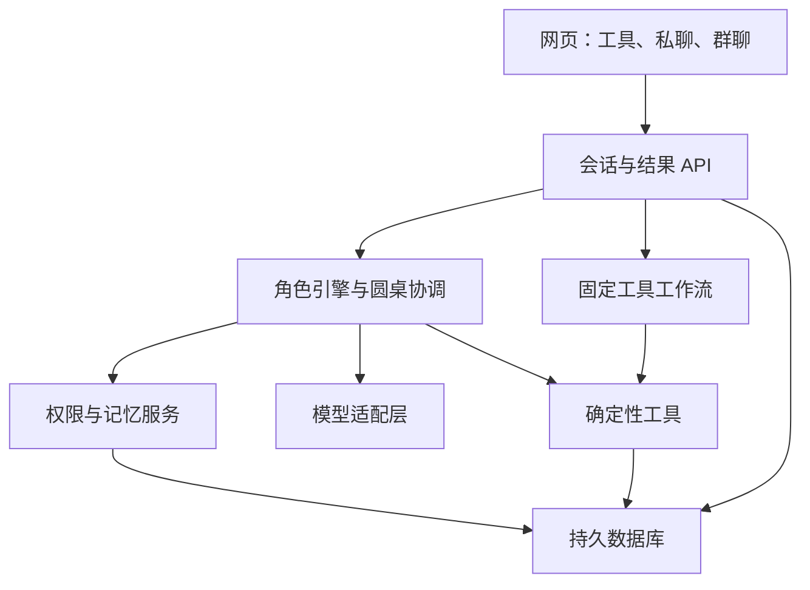

# 历史规划（保留供参考）

当前实现与限制以 README.md、changes-v02.md、validation.md 为准。下方是旧版规划，不代表当前完成状态。

# 卜犀 Buxi：AI 占卜工具与朋友陪伴应用完整方案

> 项目名称：卜犀 Buxi  
> 文档版本：1.1｜更新日期：2026-11-06  
> 状态：设计与实施基线，尚未实现、测试或部署。  
> 目标：先开发手机与电脑均可使用的网站，开源到 GitHub；后续再评估 PWA 与原生 App。

## 1. 产品定位与已确认决策

**自己看盘、抽牌、起卦、摇签，也能找熟悉的 AI 朋友一起聊。**

本产品是一套可独立使用的占卜工具，加上具有稳定人格的 AI 朋友和用户自选群聊。用户不聊天也能获得完整工具结果；愿意深入交流时，可将同一份结果带进私聊或群聊。

- 工具是基础能力：星盘、塔罗、易经、灵签均有独立页面。
- 首页提供今日运势等日常内容、工具入口和最近记录。
- 朋友提供陪伴式交流，可以闲聊、倾诉，也可以解释工具结果。
- 用户决定是否拉群、邀请谁、分享什么；不强制圆桌。
- 同一份工具结果贯穿独立页面、私聊、群聊和历史记录。
- 项目免费开源；远程模型调用、服务器和域名等费用由实际使用方承担。
- 首发中文，界面文字集中管理，为英文版留出结构。
- 不设置付费解锁悬念、关系充值、连续签到维持感情等机制。

产品提供娱乐、传统文化体验和自我探索。星盘计算可验证、签文可溯源，不代表象征性解读具有确定的现实预测能力。角色可以有预言家的世界观，但不能编造计算结果、原文或现实身份。

### 品牌名称与表达（已确认）

**卜犀 Buxi**  
**A little insight. A little company.**  
**一点启发，一点陪伴。**

| 项目 | 统一用法 |
| --- | --- |
| 中文品牌名 | 卜犀 |
| 英文品牌名 | Buxi |
| 中英文联合展示 | 卜犀 Buxi |
| 英文标语 | A little insight. A little company. |
| 中文标语 | 一点启发，一点陪伴。 |
| GitHub 仓库建议名 | buxi（以实际可用性为准） |
| 产品说明 | 看盘、抽牌、起卦、摇签，也找朋友聊聊。 |

“卜”关联占卜工具，“犀”借“心有灵犀”产生理解与回应的品牌联想；不将“犀”单字解释为知己，也不宣称名称出自某句经典。英文采用 Buxi，不将“犀”直译为 Rhino。品牌名不是角色名，三位朋友保留各自身份。

首页、登录页、README 和演示封面统一使用上述名称；空间、角色和功能名称可各自保留。品牌确认不等于已完成商标、同名产品或域名核查，正式推广前另行确认。

### 1.1 首发与暂缓范围

| 完整首版必须包含 | 后续版本 |
| --- | --- |
| 首页今日内容与四类工具入口 | 完整英文内容 |
| 本命星盘及基础点击解释 | 高级行运、复杂推运体系 |
| 塔罗单牌、三牌牌阵 | 更多牌阵与自定义牌组 |
| 周易三枚铜钱起卦 | 梅花易数、六爻纳甲 |
| 一套经核实的观音灵签签本 | 其他签本 |
| 三位固定朋友、私聊、自建群聊 | 自定义角色市场、语音与动态立绘 |
| 结果分享、历史记录、基础可控记忆 | 主动站外通知、复杂回访 |
| 本地部署、私有演示、开源文档 | 原生手机 App、规模化公共运营 |

可以分阶段交付内部版本，但不能把仅实现塔罗的版本描述成四体系完整首版。尚未实现的模块必须标为未开放，不能用模拟数据伪装已实现。

## 2. 用户、场景与产品价值

### 2.1 目标用户

| 用户 | 主要需求 | 产品回应 |
| --- | --- | --- |
| 对占卜感兴趣的新手 | 看不懂术语，不知道从哪里开始 | 独立清晰入口、重点摘要、逐层展开 |
| 喜欢日常仪式感的人 | 每天简单看看、抽一张牌或摇签 | 今日内容、每日一牌、最近记录 |
| 喜欢 AI 朋友的人 | 有个性、能接着聊、能一起做点事 | 固定角色、共享工具活动、相关记忆 |
| 想听不同角度的人 | 同一件事听听不同看法 | 可选群聊、指定发言、短消息接话 |
| 开源社区用户 | 可运行、可配置、数据由自己管理 | Docker 部署、模型适配、导出与删除 |

首版不服务于专业命理从业者的全部排盘需求，不提供真人咨询市场、社区信息流、交易和支付。

### 2.2 核心路径

1. 日常浏览：首页 → 今日内容 → 按需展开 → 离开或找朋友聊。
2. 独立工具：首页/探索 → 输入资料 → 生成结果 → 阅读、收藏或保存。
3. 结果延伸：工具结果 → 选择朋友 → 继续解读 → 可选邀请其他角色。
4. 直接聊天：朋友 → 私聊/群聊 → 如有需要，打开工具操作面板 → 带回结果卡。
5. 长期连续：历史记录 → 找到某件事 → 补充新进展 → 继续交流。

用户不必注册或填写出生资料才能浏览所有内容；哪些操作需要保存身份由部署模式决定。星盘相关功能才要求出生资料，抽牌、起卦、摇签不强制收集。

## 3. 竞争差异与验证假设

### 3.1 相对常见聊天伴侣产品

| 维度 | 常见形态 | 本项目的重点 |
| --- | --- | --- |
| 入口 | 角色与聊天 | 工具与聊天都可独立进入 |
| 无聊天时的价值 | 较依赖持续对话 | 可以独立看盘、抽牌、起卦、摇签 |
| 共同活动 | 对话与角色扮演 | 围绕实际生成并保存的结果交流 |
| 依据 | 人设和聊天上下文 | 工具事实、原文、用户记忆分开标注 |
| 记录 | 会话历史 | 会话与工具结果、现实事件相互关联 |
| 群聊 | 多角色交流 | 围绕同一结果接话，用户随时参与 |

这不是对所有竞品的穷尽判断。人格、记忆和群聊都不是本项目独有功能。

### 3.2 相对测测等产品

测测公开资料已包含 AI 对话、情感交流和多种工具解读；其隐私政策提到“陪伴小星”参考历史聊天。因此不能宣称“竞品只有报告，我们才有陪伴和记忆”。参考来源见第 20 节。

| 设计重点 | 实现方式 | 可验证的用户收益 |
| --- | --- | --- |
| 工具入口清晰 | 四类工具各自完整，结果先简后深 | 新手能自行完成任务 |
| 结果与聊天互通 | 用统一结果 ID 分享到私聊/群聊 | 无须重复输入，不丢失依据 |
| 固定朋友连续相处 | 稳定人格，延续用户允许记住的事情 | 减少重复背景介绍 |
| 用户控制群聊 | 自选成员、分享范围、指定发言与停止 | 自己掌握节奏 |
| 可控记忆 | 来源可见、可修改、可遗忘、角色权限明确 | 减少误记和意外引用 |
| 可追溯 | 事实、原文、AI 解释分别显示 | 能查看解释从何而来 |
| 开源部署 | 代码、配置、文档、数据导出 | 开发者可复用与自行管理 |

以上是设计选择及待验证的优势，不是已经证明的市场壁垒。灵签增加覆盖面，但单独增加工具数量不构成差异化。

### 3.3 防止功能拼凑的产品原则

每个功能至少服务于一种核心路径。工具结果、记录与会话共用数据对象；角色不重新生成不存在的结果；首页不堆满营销栏目；不强迫工具用户聊天，也不强迫聊天用户占卜。

核心体验假设：**“独立工具 + 熟悉的朋友 + 可选群聊 + 连续记录”比互不相通的工具和聊天更自然。** 通过用户任务和对照体验验证，不能仅通过功能完成数判断。

## 4. 信息架构与页面

| 一级页面 | 核心内容 | 二级页面 |
| --- | --- | --- |
| 首页 | 今日主题、四类快捷入口、每日一牌、最近记录、朋友问候 | 今日详细解读 |
| 探索 | 星盘、塔罗、易经、灵签 | 输入页、互动页、结果页 |
| 朋友 | 三位角色、最近私聊、已有群、创建群 | 私聊、群聊、成员与分享设置 |
| 我的 | 出生资料、记录、收藏、记忆、模型与隐私设置 | 记录详情、记忆管理、导出删除 |

建议路由：/、/explore、/astrology、/tarot、/yijing、/lots、/friends、/chats/:id、/records/:id、/me、/settings。

### 4.1 首页

- 顶部：日期、用户时区、简短问候。
- 今日运势：短主题、两三句解释、查看依据入口。
- 四类工具：星盘、塔罗、易经、灵签。
- 每日一牌：用户主动抽取，当日已抽则显示原结果。
- 最近一次记录或上次聊到的事。
- 朋友卡片：继续聊；不使用内疚话术促使用户回访。

| 内容 | 依据与规则 |
| --- | --- |
| 今日星象/通用主题 | 当天计算的星象与通用解释，明确是通用内容 |
| 我的今日运势 | 已有本命资料与当天基础行运；未实现行运前不能用通用文案冒充 |
| 每日一牌 | 用户时区下的日期 + 用户身份确定每日记录；并发点击只生成一次 |
| 朋友问候 | 人设与获准背景，不假装是星盘计算结论 |

今日内容使用明确的日期和生成版本；刷新不重新随机生成。个性化缓存按用户、本命盘版本、日期、时区、解读版本隔离。不提供无依据的“成功率 87%”等精确数字。无出生资料时仍可使用通用内容和每日一牌。

### 4.2 通用结果页

从上到下：结果名称与时间 → 牌面/星盘/卦象/签文 → 简短解读 → 可展开详情 → 依据与来源 → 保存、收藏、找朋友、邀请讨论。

LLM 不可用时，仍显示已计算结果和合法静态文本，允许稍后重试解读。重试解读不能再次抽取。AI 内容标注为解释，传统原文单独展示。

### 4.3 视觉与可用性

暖色背景、轻量星空或纸张元素、角色独立代表色；正文保持对比度。首版静态立绘，短动画可跳过，支持减少动态效果。小屏无横向溢出，工具图可缩放，点击元素有文字列表替代。键盘可操作，加载、失败、空状态均明确。

## 5. 四类独立工具详细规格

### 5.1 塔罗

- 首版：单牌、三牌牌阵；三牌各位置含义在抽取前展示。
- 问题可选；无问题时提供一般象征性解读。
- 代码从明确的牌组无放回抽取；正逆位策略固定并记录。
- 保存牌组版本、牌 ID、位置、朝向、随机记录、算法版本和时间。
- 结果包含单牌解释、位置含义和整体解读。
- 牌图必须有可用授权；未落实图像授权可先用自制文字卡面。
- 正常用户不能通过指定 seed 伪装自然抽取；测试接口可在非生产模式支持 seed。
- 同一输入结果不随模型或提示词变化，解释可以版本化更新。

### 5.2 星盘

- 首版范围：本命盘、日/月/行星、可计算时的上升与宫位、主要相位、基础当天行运。
- 出生输入：当地日期时间、出生地、经纬度、IANA 时区、时间精度。
- 记录采用的黄道体系、宫制、天体范围、相位及容许度配置；不能混用配置。
- 首版建议热带黄道；宫制在引擎验证后确定并固定显示，切换产生新版本。
- 历史夏令时或模糊时间必须处理；无法消除歧义时让用户选择，不静默猜测。
- 时间未知时禁用确定的上升/宫位解读；变化敏感的月亮位置也应标注不确定性，不能仅隐藏宫位。
- 图形元素可点击，先显示结构化事实，再显示白话解释与关联元素。
- 计算由排盘引擎完成；LLM 不能自行计算角度、相位或补造缺失宫位。
- 引擎、星历文件、包装库各自的版本与许可证在采用前核实。

### 5.3 易经

首版明确是周易三枚铜钱法，不含六爻纳甲、六神、世应或梅花易数。

- 定义硬币两面数值和三枚组合规则，形成 6、7、8、9 四类爻值。
- 六次记录从下到上组成六爻；6/9 为动爻，按规则得变卦。
- 若每面等概率，单爻分布应为 6:1/8、7:3/8、8:3/8、9:1/8；用测试验证实现。
- 通过完整映射表查询本卦和变卦，不由模型猜编号或名称。
- 展示动爻、本卦与变卦对应原文；没有动爻时不制造变卦信息。
- 多动爻首版展示相关爻辞，并说明所采用的解读约定，不宣称唯一断法。
- 原文经逐项核实，白话翻译单独标注；不凭模型补写缺失原文。
- 首版不依赖农历干支，避免引入与此起卦规则无关的复杂计算。

### 5.4 观音灵签等摇签

- 首版一套明确来源和版本的观音灵签，不默认不同地区、寺院或出版版本完全相同。
- 数据包含签本 ID、版本、签号、标题、原文、出处，以及来源确有的其他字段。
- 现代注解与插画单独核对授权；古老原文不代表所有现代材料均可自由复制。
- 代码在所选签本中抽取；明确是数字随机抽签的文化体验。
- 动画不改变抽取结果；用户确认后再保存和显示。
- 原文与 AI 白话分开展示；签本有缺项时阻止该版本上线，不临时编造。
- 若后续加入掷筊等流程，需单独定义规则与出处；首版不默认附加。
- 用户主动重抽生成新的记录，并能看到之前的结果。

## 6. AI 朋友与关系体验

### 6.1 三位固定角色（名称可更换）

| 角色 | 个性 | 专长 | 对话要求 |
| --- | --- | --- | --- |
| 绯月 | 活泼、敏锐、略俏皮 | 塔罗与情绪表达 | 简短自然，不夸张表演 |
| 星澈 | 细致、温柔、有冷幽默 | 星盘与模式观察 | 不用星座给用户贴永久标签 |
| 知微 | 沉稳、直接、有生活感 | 易经、灵签与文本解释 | 不堆古文、不假装宗教权威 |

三位均可普通聊天，也可讨论同一工具结果。专长是偏好和能力配置，不意味着每位一发言就必须算一次。

角色设定包含身份说明、语气、追问习惯、表达分歧方式、工具偏好、参考对话和禁用行为。默认亲近的朋友关系，不虚构真人身份、不要求排他关系、不因用户离开责备用户。

### 6.2 私聊

普通消息 → 判断是否需要检索或工具 → 回复/追问/打开操作卡。用户未请求占卜时不强行抽取；涉及新抽取时由用户点击确认。回复以短段为主，可展开，避免每轮长篇分析或连续追问。

### 6.3 群聊

- 从朋友页创建，或从结果页选择成员后创建。
- 默认一至两位发言，用户可继续、指定角色或总结。
- 用户发言优先；没有新信息可补充时等待用户。
- 每位角色读取其有权看到的内容和前面实际发言，不能机械并行生成三份相同报告。
- 加入群的角色默认可见该群已共享历史，加入前在界面说明；退出后不接收新内容。
- 私聊记忆不因拉群自动公开；分享时预览“工具结果”“问题背景”“选中消息”。
- 分享来源删除后，关联视图与检索同步处理，并说明已经看过的内容无法撤回他人认知。
- 默认每轮最多三条角色消息；用户可停止。技术上取消未完成调用，并丢弃过期轮次输出。
- 不使用多数票来证明某个预测更准确。

## 7. Agent 的体现与边界

### 7.1 三类工作明确分开

| 类型 | 例子 |
| --- | --- |
| 确定性工具 | 抽签、抽牌、星盘计算、卦象生成、原文查询 |
| 固定工作流 | 点击抽签 → 保存结果 → 生成解释 → 显示 |
| Agent | 根据问题选择检索与工具，观察结果，再决定追问、继续或结束 |

有名字和头像不等于 Agent；单次报告生成也不等于 Agent。

### 7.2 Agent 决策点

| 能力 | 自主决策 | 程序约束 |
| --- | --- | --- |
| 对话 Agent | 是否追问，查哪份结果，检索哪些背景 | 工具白名单、参数校验、访问权限 |
| 星盘导航 | 根据问题选相关落位、关联元素 | 必须引用已计算 element_id |
| 圆桌协调 | 下一位是谁、是否有必要继续 | 指定发言优先、轮数预算、可取消 |
| 记忆整理 | 哪条用户信息值得保留，是否是旧事件更新 | 来源类型、权限、敏感信息策略 |
| 历史续聊 | 找到哪次记录，如何区分当时与现在 | 多候选需澄清，不猜测指代 |
| 后续回访 | 是否仍有意义、如何开口 | 明确授权、时间、次数、去重 |

### 7.3 对话循环

接收消息 → 构建最小必要上下文 → 模型提出回复或工具请求 → 服务端检查权限与参数 → 执行工具 → 返回结构化结果 → 模型继续 → 达到完成条件或预算后结束。

初始预算建议：每个用户轮次最多 4 次工具执行；群聊最多 3 条角色消息；总体超时与 Token 上限在服务端设置。数值是可调工程默认值，不是已验证性能结论。所有子调用计入总预算。

Trace 展示工具、引用来源、耗时、错误和简短决策摘要，不输出内部思维链、完整密钥或无关私聊。

### 7.4 工具契约草案

| 工具 | 参数重点 | 返回 |
| --- | --- | --- |
| get_result | result_id | 原始事实、来源、版本 |
| get_chart_element | result_id, element_id | 落位、相位、关联元素 |
| search_records | query, filters | 有权限的候选记录 |
| search_memory | query, scope | 带来源的可用记忆 |
| lookup_text | collection_id, version, item_id | 核实原文、出处 |
| propose_memory_change | source_message_id, operation | 待校验的变更提案 |
| propose_tool_action | system, params | 用户确认操作卡 |
| suggest_next_speaker | context, candidates | 角色 ID 或等待 |

所有 user_id 从认证会话注入，不接受模型自行指定。抽取动作通过用户确认接口执行；工具调用日志只记录必要数据。

## 8. 记忆、隐私与记录

### 8.1 记忆结构

| 类型 | 例子 | 策略 |
| --- | --- | --- |
| profile | 称呼、语言、明确偏好 | 低频更新，冲突确认 |
| event | 面试、offer、搬家 | 保留状态历史 |
| state | 最近疲惫、近期关注点 | 有效期与失效机制 |
| shared_experience | 某次抽牌与对话 | 链接原始记录 |
| summary | 对话摘要 | 保留来源和原权限 |

来源类型分为用户陈述、用户确认总结、模型推测、传统解读。只有前两类可作为用户背景事实；模型推测不自动升级为事实。

私聊默认仅该角色使用；公共资料由用户选择共享；群聊记录仅对相应群与授权角色开放。检索前过滤权限，不能检索后再让模型决定是否隐藏。

### 8.2 用户控制

查看记忆 → 查看来源与可见范围 → 修改、停止使用或删除。撤回后清理索引、摘要与缓存引用，并阻止从旧消息自动重建该记忆。导出包含记录及来源；不导出服务端密钥。

本地部署表示数据保存在部署环境；远程模型调用仍会发送选入请求的内容，不能宣传“BYOK 就等于数据不离开本机”。

### 8.3 统一记录

保存原始输入、工具结果、来源版本、解释版本、时间、相关会话与用户后续补充。名称采用“我的记录”，不展示命中率营销。用户可以记录后来发生了什么，系统不替自己辩解“其实也算准”。

## 9. 技术架构与选型

建议沿用已有 React + FastAPI 经验，先做模块化单体。

| 层 | 建议 |
| --- | --- |
| 前端 | React + TypeScript + Vite，响应式组件 |
| 后端 | Python + FastAPI，Pydantic 数据契约 |
| 数据访问 | SQLAlchemy + Alembic 迁移 |
| 单机存储 | SQLite，本机持久卷 |
| 检索 | 权限筛选 + 结构化检索/关键词起步；中文效果实测后决定分词与向量 |
| 模型层 | 一家已验证支持工具调用的服务起步，薄适配层 |
| 流式传输 | HTTP 流式响应/SSE 事件格式 |
| 调度 | 后续独立 worker，任务存数据库 |
| 部署 | Docker Compose + 同源反向代理 |
| 质量 | Python 测试、前端类型检查、关键端到端流程 |

不将某个“兼容 API”视为全部行为兼容；流式工具调用、取消、用量返回需分别验证。依赖具体版本在创建代码时选定并锁定，本方案不声称已经验证某版本组合。



计算与解释分离：计算结果不可被模型修改；通用解释可以缓存，个性化文本必须按用户与记忆版本隔离。

## 10. 数据模型

| 表 | 主要字段 |
| --- | --- |
| users | id, locale, timezone, preferences |
| profiles | user_id, birth_input, precision, sharing_scope |
| characters | id, persona_version, tool_permissions |
| conversations | id, owner_id, type, title, turn_version |
| conversation_members | conversation_id, character_id, joined_at, left_at |
| messages | id, conversation_id, author, content, created_at |
| results | id, owner_id, system, input, facts, algorithm_version, content_version |
| interpretations | id, result_id, model, prompt_version, text, cited_ids |
| result_shares | result_id, conversation_id, shared_fields, revoked_at |
| memories | id, owner_id, layer, source_type, scope, expires_at, status |
| memory_sources | memory_id, message_id/result_id |
| event_updates | event_id, state, source_id, created_at |
| daily_entries | user_id, local_date, timezone, kind, result_id |
| tool_runs | turn_id, tool_name, status, latency, usage |
| content_sources | collection_id, item_id, version, text, attribution, license |
| followups（后续） | event_id, consent_id, due_at, status, dedup_key |

结果创建使用幂等键，同一请求重试返回同一结果；每日记录有唯一约束。数据库权限查询统一经过服务层。首次单用户部署也保留 owner_id，不能未来多用户上线时才补隔离。

## 11. API 草案与错误行为

| 接口 | 用途 |
| --- | --- |
| GET /api/home | 今日内容和最近记录 |
| POST /api/results/tarot | 创建牌阵结果 |
| POST /api/results/yijing | 创建卦象 |
| POST /api/results/lots | 创建灵签结果 |
| POST /api/charts | 创建本命盘 |
| GET /api/results/{id} | 获取获准结果 |
| POST /api/results/{id}/interpretations | 解读或重试，不重抽 |
| POST /api/conversations | 创建私聊或群聊 |
| POST /api/conversations/{id}/messages | 发消息并流式响应 |
| POST /api/conversations/{id}/cancel | 取消本轮 |
| POST /api/conversations/{id}/shares | 明确分享结果或消息 |
| GET/PATCH/DELETE /api/memories/{id} | 查看、纠正、遗忘 |
| GET /api/export | 导出用户数据 |
| DELETE /api/account-data | 删除用户数据 |
| GET /health/live、/health/ready | 进程和依赖就绪状态 |

消息事件至少区分角色、文本增量、工具开始/结束、完成、取消和错误。重连或重试不能重复落库。服务端生成事件序号和轮次版本，过时输出不插入新一轮。

错误统一返回可读提示、错误码和 request_id。模型失败时保留原结果；计算失败时不调用模型补造。出生信息缺失、权限不足、额度耗尽、内容源缺项分别处理。

## 12. 内容与随机性治理

- 为四类工具维护独立内容清单、来源、版本和校验状态。
- 塔罗卡面和现代解释文本授权单独记录。
- 易经 64 卦映射、爻顺序、原文条目完整性做自动校验和人工抽检。
- 灵签上线前验证所选版本的签号、文本、条目数和来源一致性。
- 星盘以已知样例对照验证，记录时间体系与容许误差。
- 随机结果由服务端产生；测试使用固定输入/seed，生产保存必要复现信息。
- 可复现只表示相同规则下复现结果，不证明预测效力或随机过程不可操控。
- 导入文本是数据，不是执行指令；不能从签文或聊天内容中执行代码、网络请求或系统提示。

## 13. 部署方案与环境配置

### 13.1 当前状态

本文件是开发部署规格，不包含应用源码、Dockerfile 或 compose.yaml。以下命令是在相关文件实现并通过验证后的操作约定，当前不能据此声称网站已部署。

### 13.2 三种运行模式

| 模式 | 身份与网络 | 数据与费用 |
| --- | --- | --- |
| 本地个人版 | 只绑定本机回环地址，可简化登录 | 数据持久化在本机，部署者配置模型 |
| 私有演示版 | 身份认证或访问网关保护 | 持久卷，有限访问者，服务端费用上限 |
| 公开演示版 | 独立访客会话、严格限额 | 临时数据与明确过期规则，示例人物展示长期记忆 |

建议先完成本地版，再上私有演示。公开长期多用户服务需完成认证、数据隔离、滥用控制和备份恢复验证。无认证的个人模式不得直接暴露公网。

公开演示不要求访客输入自己的 API Key。BYOK 首版通过部署者环境变量配置，暂不做公开网站的用户密钥托管。

### 13.3 容器布局

- web：静态前端及反向代理；同源将 /api 转发到 api。
- api：FastAPI 服务；仅容器内部端口。
- data：持久卷存数据库与必要资源。
- worker：回访上线后加入，数据库任务去重。
- TLS：私有/公开服务器入口启用 HTTPS；不要只发布纯 HTTP 登录和聊天。

SQLite 适用于初期单实例；不在共享网络文件系统上运行多个写入实例。需要多实例或更多并发写入时迁移 PostgreSQL，先做迁移与恢复演练。

### 13.4 计划中的 .env.example

```dotenv
APP_MODE=local
APP_ORIGIN=http://localhost:8080
DATABASE_URL=sqlite:////data/buxi.db
MODEL_PROVIDER=openai_compatible
MODEL_BASE_URL=
MODEL_API_KEY=
MODEL_NAME=
SESSION_SECRET=
DEFAULT_LOCALE=zh-CN
GROUP_MAX_MESSAGES_PER_TURN=3
AGENT_MAX_TOOL_CALLS=4
REQUEST_TIMEOUT_SECONDS=90
ENABLE_FOLLOWUPS=false
DEMO_MODE=false
LOG_LEVEL=INFO
```

这些是拟定字段名，应用实现应与其保持一致。密钥字段留空并在运行时配置；SESSION_SECRET 由部署者生成足够随机的值。生产启动时检查必填项，拒绝默认密钥。请求预算、每日额度与 Token 上限补充为配置；费用未知时不伪报精确金额。

管理员才能配置模型地址，禁止普通用户任意指定服务端请求目标。前端环境变量、构建产物、日志、错误栈与导出均不得包含模型密钥。

### 13.5 代码完成后的部署步骤

1. 安装并确认 Docker 与 Compose 可用，获取已标记版本的完整仓库。
2. 将 .env.example 复制为 .env，填写模型配置和认证配置。
3. 检查内容数据与许可证清单，确认静态资源完整。
4. 执行数据库迁移；下列模块名是计划中的仓库契约。
5. 构建启动，检查健康端点。
6. 用示例数据测试工具、私聊、群聊和取消。
7. 重启服务，确认历史记录仍存在。
8. 上线私有服务器时配置域名、HTTPS、访问保护及持久卷。
9. 进行一次备份恢复演练，再开放访问。

```powershell
Copy-Item .env.example .env
# 编辑 .env 后继续；以下命令要求仓库已实现对应服务与迁移模块
docker compose build
docker compose run --rm api python -m app.migrate
docker compose up -d
docker compose ps
docker compose logs --tail 100 api
Invoke-RestMethod http://localhost:8080/health/ready
```

web 必须转发健康端点。应用容器从官方基础镜像构建并锁定依赖；不使用已弃用的旧 FastAPI 打包镜像。Docker 的卷与 Compose 行为参考第 20 节。

### 13.6 持久化、备份与升级

- SQLite 使用一致性备份接口，或停止写入后备份；不能在 WAL 写入过程中只复制主数据库文件。
- 备份包含数据库、内容版本与恢复说明；密钥单独管理。
- 定期清理临时演示数据，记录删除任务是否成功。
- 升级前备份，测试迁移；旧镜像回滚不等于数据库自动回滚。
- 保留可恢复的版本，出现不兼容迁移时按已演练流程恢复。
- 停止服务使用 docker compose down；不要为正常停机使用删除卷的选项。

## 14. 代码目录建议

| 路径 | 职责 |
| --- | --- |
| README.md | 定位、截图、启动、当前限制 |
| docs/plan.md | 本方案 |
| docs/architecture.md | 架构、权限和接口 |
| docs/content-sources.md | 原文、图像、许可清单 |
| docs/deployment.md | 实际可运行的部署手册 |
| server/app/api/ | HTTP 接口与认证 |
| server/app/agent/ | 角色循环、协调器、预算 |
| server/app/tools/ | tarot、astrology、yijing、lots |
| server/app/memory/ | 来源、权限、检索、遗忘 |
| server/app/services/ | 结果、分享、日常内容 |
| server/app/models/ | 数据模型 |
| server/app/migrations/ | 数据库迁移 |
| server/app/content/ | 核实后的版本化内容 |
| web/src/pages/ | 首页、工具、朋友、我的 |
| web/src/components/ | 牌面、星盘、卦象、签文、聊天 |
| tests/、evals/ | 工具测试、权限测试、多轮评测 |
| compose.yaml、.env.example | 部署契约 |

.gitignore 排除 .env、数据库、真实用户对话、备份与运行日志。示例使用合成资料。

## 15. 开发阶段与完成门槛

| 阶段 | 交付 | 验收门槛 |
| --- | --- | --- |
| M0 基础骨架 | 页面导航、数据模型、模型适配、容器与健康检查 | 空白环境可启动，配置失败有提示 |
| M1 塔罗闭环 | 独立抽牌、结果、解读、保存、单角色聊天 | 解读重试不重抽；刷新可恢复 |
| M2 易经与灵签 | 规则、来源数据、互动、结果 | 卦映射与签文验证通过，无编造原文 |
| M3 星盘与首页 | 本命盘、点击解释、今日基础内容 | 已知样例对照通过，未知时间正确降级 |
| M4 朋友与群聊 | 三角色、自选群、指定发言、结果分享 | 用户可插话停止；无过期消息落库 |
| M5 连续记忆 | 来源、事件状态、可见范围、遗忘 | 私聊不越权；纠正后不重复旧信息 |
| M6 发布 | 演示、评测、文档、许可、备份 | 干净环境部署与恢复流程通过 |

每阶段都可私有部署验证。M0–M1 的部署是内部开发版；M6 才是本方案定义的四类工具完整首版。

以每周 10–15 小时的个人开发为假设，可暂留 10–16 周规划窗口；这是排期假设，不是承诺。资料核实与星盘可视化可能改变周期。M1 后按实际速度重新估算，不沿用原先仅塔罗的 6–9 周估计。

超期时优先减少角色动画、高级排盘、牌阵数量和界面装饰，不取消已确认的独立工具入口，不用模型生成假计算替代工程实现。

## 16. 测试与评测

### 16.1 必须通过的工程检查

- 塔罗无重复牌，方向与位置正确，幂等请求只创建一份结果。
- 铜钱规则、六爻顺序、动爻与变卦映射正确。
- 灵签数据无缺项，签号与原文版本匹配。
- 星盘样例与确定配置对照，时间未知、夏令时歧义有处理。
- 私聊、群聊、结果、导出、删除接口均校验 owner 与授权。
- 群聊取消后不追加旧回复；超时不重复写入。
- 模型故障不丢工具结果，不伪造成功。
- 每日缓存跨日期、时区与用户无串用。
- 删除或撤回记忆同步影响摘要、索引和后续检索。
- 容器重启保留数据，备份恢复后记录一致。

### 16.2 Agent 场景集

首轮至少准备 40 条有预期行为的多轮场景，覆盖记忆纠错、私聊权限、工具失败、模糊指代、指定发言、重复观点、用户插话、预算耗尽及高风险问题。

记录工具事实一致率、越权次数、旧信息复用次数、无效工具调用、重复发言、首响应时间、总时间和 Token。数据较少时报告样本数，不把“零次观察到”写成永不出错。

### 16.3 产品验证

邀请 5–8 位早期用户用于发现问题，任务包括独立摇签、点击星盘解释、结果带进私聊、拉群、纠正记忆。

对照 A：单朋友 + 同一结果；B：可选群聊 + 同一结果。观察任务完成、是否主动参与、是否觉得信息重复、是否愿意再次使用。用户不喜欢群聊时保留为次要入口，不为技术展示强迫使用。

## 17. 安全与陪伴边界

- 对涉及医疗、投资或人身安全的重大问题，不依据牌面、签文给确定结论或行动命令。
- 遇到明显危机，退出占卜解释，采用适当支持流程；规则与分类判断共同兜底。
- 不恐吓、不贩卖灾祸、不暗示付费改变命运。
- 不冒充真实宗教组织、真人咨询师或具有超自然认证。
- 不让多个角色一致表态制造虚假权威。
- 不鼓励用户只信任 AI 或放弃现实支持。
- 产品明确 AI 身份与内容性质，说明保存和模型传输范围。
- 对外公开运营前再按实际服务地区、受众与数据处理方式评估相应要求，本方案不构成上线许可判断。

## 18. 开源与作品集交付

README 应先展示用户能完成什么，再说明技术：截图、短视频、快速启动、完成状态、限制与路线图。附架构、数据来源、Agent/非 Agent 分工、测试结果和失败案例。

许可证需在核实排盘引擎、包装库、数据、牌图后确定。Swiss Ephemeris 官方列明 AGPL 与专业商业许可路径；本方案不默认采用 MIT 或认定任何依赖天然兼容。未完成许可确认前，不宣称已正式开源发布。

推荐展示故事：独立摇签/抽牌 → 保存 → 找朋友 → 自选群聊 → 纠正一条记忆 → 下次继续。用真实测量数据补充，不编造留存率、准确率或成本节约。

作品集描述草案：

> 卜犀 Buxi：设计并实现支持星盘、塔罗、易经与灵签独立使用的 AI 陪伴应用，以统一结果记录连接私聊与用户自选群聊；通过工具调用、带权限的长期记忆和动态发言协调延续同一件事，并评估工具一致性、记忆准确性与交互体验。

以上描述在对应能力实现后使用。

## 19. 开发启动清单

可直接按以下默认项开始，不需要为了品牌名或视觉细节阻塞基础开发：

- [ ] 项目名称卜犀 Buxi，仓库建议命名 buxi，首发中文、手机优先的响应式网站。
- [ ] 先建立 React/FastAPI/SQLite 单机骨架及迁移。
- [ ] 定义 result_id、conversation_id、source_id 与权限契约。
- [ ] 以塔罗完成第一条端到端路径，随后按 M2–M6 补齐。
- [ ] 模型采用部署者环境配置，验证一条真实工具调用与流式返回。
- [ ] 易经与灵签先核实数据，再写解释提示词。
- [ ] 星盘引擎在 M3 前完成许可和样例验证。
- [ ] 三位角色先用静态头像与人格配置，避免美术阻塞。
- [ ] 先本机部署，首次上线采用私有访问。
- [ ] 记录已实现、未实现和失败项，不把计划功能写成已交付。

需要后续落实的外部条件：实际模型服务与密钥、签本来源与授权、排盘引擎及许可证、上线服务器与域名。缺少这些时仍可开发骨架，但相关能力不能被标成已完成。

## 20. 参考资料

资料用于技术和竞品事实核对，不代表已经实测相关产品的所有能力。产品设计、默认预算与排期均为本项目建议。

1. 测测产品介绍：https://www.cece.com/product/
2. 测测 Google Play 介绍：https://play.google.com/store/apps/details?hl=zh&id=com.lingocc.cc5
3. 测测隐私政策（含陪伴小星历史聊天说明）：https://m.cece.com/agreement/privacy_service/zh_CN/
4. Character.AI 记忆功能：https://blog.character.ai/memory/
5. FastAPI 容器部署：https://fastapi.tiangolo.com/deployment/docker/
6. Docker Compose 启动：https://docs.docker.com/reference/cli/docker/compose/up/
7. Docker 持久卷：https://docs.docker.com/engine/storage/volumes/
8. SQLite FTS5：https://www.sqlite.org/fts5.html
9. Swiss Ephemeris 官方说明：https://www.astro.com/swisseph/swephinfo_e.htm

---

**首版验收原则：四类工具能够独立完成任务；同一份结果能够进入私聊和用户自选群聊；相关记忆准确且权限清楚；干净环境可以按文档启动并保留数据。**

